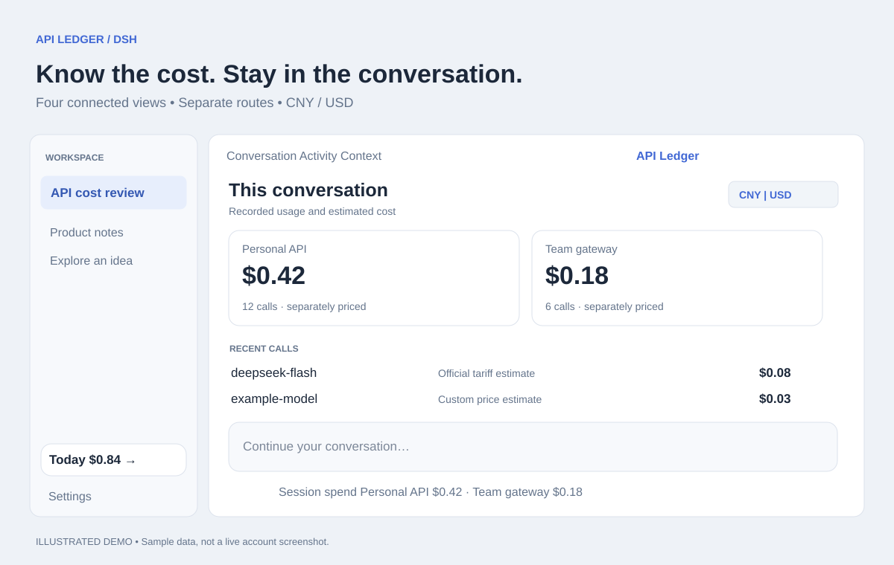

# DSH API 账本

[English / 中英双语](README.md)



*功能示意图，使用演示数据，不是真实账户截图。*

**不用离开会话，就能查看本次对话花了多少钱。**

API 账本把 Token 用量和 API 估算费用放进 DSH：会话完整报告、设置页总览、输入框下方的会话金额，以及左下角的一行今日金额。

### 哪些地方用起来方便？

- **随手查看费用**：不用频繁打开独立报表；会话费用放在输入框下面，今日费用放在侧边栏，点击即可打开设置中的账本。
- **相同模型可以按不同接口计价**：价格按「路由 + 模型」配置，官方接口和企业网关互不混用。
- **分组由使用者决定**：默认按路由分别统计，需要时再设置相同账单分组。不会因为共用凭据引用就自动合并，也不会把展示分组当作共用余额。
- **四处展示同步切换币种**：CNY/USD 选择会保存并同步，避免不同页面各用一种显示币种。
- **能看懂费用怎么来的**：最近调用标明计价来源，未配置单价显示未计价，历史记录保留当时使用的单价。
- **无需部署额外服务**：用量与配置保存在本机，不读取 API Key 的值，也不上传到插件自建的统计服务。

这些是插件的具体使用价值，不代表其他用量插件都不具备相同能力。这里统计的是已记录用量与估算费用，不是供应商账单或账户余额。

### 四处展示

| 位置 | 用途 |
| --- | --- |
| 会话 → API 账本 | 本会话费用、最近调用、模型分布、Token 构成和用量趋势 |
| 设置 → API 账本 | 跨会话报表、周期筛选、今日／昨日对比、账户与计价 |
| 会话输入框下方 | 本会话已用金额 |
| 侧边栏左下角 | 单行今日费用，点击打开账本设置 |

### 安装

需要 Node.js 20+ 和兼容的 DSH。已在 DSH Desktop 2.0.13／内置 DSH 0.1.5-rc.2 验证；插件无需构建，没有运行时 npm 依赖。

**DSH Desktop：从 GitHub 安装**

```sh
git clone https://github.com/LAwLi3tCoding/dsh-api-ledger.git
cd dsh-api-ledger
node scripts/install.mjs
```

重启 DSH 后，打开「设置 → API 账本」或会话的「API 账本」Tab。安装使用本地链接，请保留克隆目录。更新时执行 `git pull` 后重启；卸载该链接安装时执行 `node scripts/install.mjs --uninstall`。

**DSH CLI：安装到 CLI 管理的 profile**

```sh
# GitHub 安装
dsh plugin --profile web add github:LAwLi3tCoding/dsh-api-ledger

# npm 安装
dsh plugin --profile web add dsh-api-ledger
```

将 `web` 换成自己的 CLI profile。DSH 0.1.5-rc.2 的 `desktop` profile 由 Electron 专管，不能直接使用 `dsh plugin --profile desktop add ...`。桌面端请使用上面的安装脚本，或在市场收录完成后通过桌面市场安装；提交 PR 不等于已经上架。

### 配置计价

打开「设置 → API 账本 → 账户与计价」。每个账户（路由）先列出它已知的全部模型和当前计价方式，已单独配置的排在上面：

- 「编辑」把该模型载入下面的表单；改完点「保存此路由」。保存后卡片停在这个模型上，不会跳回第一个。
- 「删除」只清掉该模型在账本里的价格，保留账户名称、分组和其余模型。
- 「新增模型价格」清空表单，直接输入模型 ID 即可给一个还没调用过的模型预先定价。
- 一个账户可以配任意多个模型；同一个模型在不同账户分别配置。

| 方式 | 含义 |
| --- | --- |
| 价目表估算 | 绑定一张价目表（模型 → 单价，外加可选的时段规则），按请求开始时间在该表自己的时区里判断峰谷与节假日 |
| 自定义单价 | 按每百万 Token 填写非缓存输入、输出、缓存读和缓存写价格及币种；允许零价格 |
| 仅记录用量 | 不猜测费用；未配置时的默认方式 |

**计价与「这个账户是不是官方直连」解耦。** 内置价目表 `deepseek-public-2026`（核验日期 **2026-09-21**）覆盖 `deepseek-flash`、`deepseek-v4-flash`、`deepseek-v4-flash-vision-exp`、`deepseek-v4-pro`，并带峰谷规则：工作日（时区 `Asia/Shanghai`，下同）09:00–12:00 与 14:00–18:00 为高峰，表中价格是非高峰基准价，高峰乘 2；节假日按 [2026 年国务院安排](https://www.gov.cn/zhengce/zhengceku/202511/content_7047091.htm)算非高峰。**任何账户都可以绑定它**——包括不消耗个人 DeepSeek 额度的企业网关；被识别为 [DeepSeek 官方直连](https://api-docs.deepseek.com/quick_start/pricing/)的账户只是默认绑定它。绑定公开价目表只表示按该口径估算，不代表该账户实际按此扣费。

**生效方式**：「自动峰谷」按上表随请求时间变化；「仅基准价」固定用表中的基准价（等价于原来的参考价快照），不看时间与节假日。价目表有峰谷规则、但没有当前年份的节假日表时，「自动峰谷」会把该模型记为未定价，而不是猜一个日历。

官方直连按实际 URL 识别，并考虑 DeepSeek 适配器的启动环境覆盖；名称包含 DeepSeek 不代表官方直连。价目表随插件版本更新，并非实时拉取。

**自定义价目表（配置层，暂无 UI 编辑器）**：在 `$DSH_HOME/api-ledger/config.json` 里加 `tariffs` 段：

```json
"tariffs": {
  "acme-gateway": {
    "label": "ACME 网关", "currency": "CNY", "timeZone": "Asia/Shanghai",
    "verifiedAt": "2026-10-01", "source": "https://intranet.example/pricing",
    "peak": { "days": "mon-fri", "windows": ["09:00-12:00"], "multiplier": 1.5 },
    "holidays": { "2026": [["01-01", "01-03"]] },
    "models": { "deepseek-v4-pro": { "inputPerM": 4, "outputPerM": 12, "cacheReadPerM": 0.4 } }
  }
}
```

缺省值：`currency` 为 USD、`timeZone` 为 `Asia/Shanghai`；没有 `peak` 即恒定价格；写成内置同名 id 不会覆盖内置表。绑定写法：

```json
"pricing": { "corporate-gateway/deepseek-v4-pro": { "mode": "tariff", "tariff": "deepseek-public-2026", "window": "auto" } }
```

旧写法 `{ "mode": "official" }` / `{ "mode": "reference" }` 继续可用、语义不变；在设置页保存该模型时会自动改写成等价的 `tariff` 绑定。已在记录中冻结的历史单价不会因此改变。

名称与分组调整会更新历史报表的展示，修改单价只影响后续调用。已有自定义配置不会被升级覆盖。重置／删除账本配置保留 DSH 模型配置与历史调用。历史及停用路由单独折叠展示；只有账本配置、没有历史和当前模型配置的路由，删除后会从列表消失。

### 统计边界与本地数据

- CNY/USD 是**展示折算**，固定使用 `1 CNY = 0.14 USD`，不是实时汇率，也不是供应商的币种结算比例。
- 调用结束并上报用量后计入；页面可见时每 10 秒刷新。「今日」按客户端本地日历计算。
- 金额是**估算费用**，不是官方账单、余额、预算或订阅扣费。部分调用未计价时，只汇总已知费用。
- 历史金额和原始单价不变。疑似将 USD 数字标成 CNY 的旧记录会显示提示，不自动重算。
- 非缓存输入与缓存 Token 分开计价，推理 Token 不重复累加；适配器需要提供兼容的标准化用量。
- 安装前的调用不补录。缺失用量无法恢复，当前进程会显示缺失次数。嵌套调用会去重，但一个外层调用扇出多个上游流仍可能漏计。
- 配置位于 `$DSH_HOME/api-ledger/config.json`；逐次记录保存在 `records.jsonl`，`rollup.json` 为派生汇总。未设置 `DSH_HOME` 时使用 `~/.dsh/api-ledger/`。这些本地数据及凭据不随插件分发。内存最多保留最近 200,000 条记录。

### 开发与反馈

```sh
npm run check
npm test
npm pack --dry-run
npm run publish:check   # 发布闸门
```

测试覆盖计价边界、官方接口识别、历史金额不变、配置冲突、同源写入、流式捕获、报表周期、双语与四处展示。问题请提交到 [Issues](https://github.com/LAwLi3tCoding/dsh-api-ledger/issues)，使用匿名示例，不要上传 API Key 或私人会话日志。

**发布闸门。** `npm run publish:check` 检查的是**打包产物**而不是源码树，出现以下任一情况就拒绝发布：工作区有未提交改动、包内文件未提交、产物里含凭据形态或禁止出现的名称、包内代码语法错误或装不起来、版本已存在于 registry、测试不通过。`npm publish` 通过 `prepublishOnly` 自动执行它，无法跳过。不该外发的名称放在 git-ignored 的 `.publish-deny.txt`（每行一个正则）里，这样这个脚本本身可以公开。

许可证：[MIT](LICENSE)。
